# Varman 4.0 — Research Closure & Limitations Report

This document records the scientific findings, benchmark provenance, biometric methodology, and operational limitations of the **Varman 4.0** adversarial facial protection engine.

---

## 1. Algorithmic Architecture: Paste-Aware Optimization

The authoritative Hard Mode engine is implemented in [`app/protection/paste_aware_engine.py`](../app/protection/paste_aware_engine.py). It reproduces the research `RegionAblationEngine` by embedding the differentiable paste-and-realign optimization loop directly into the PGD iterations.

```mermaid
flowchart LR
    A["Aligned Crop 112×112 + δ"] --> B["Differentiable Grid Paste (Affine M)"]
    B --> C["Soft Mask Feathering (σ=4.0, Scale=1.15)"]
    C --> D["Full Context Canvas"]
    D --> E["Straight-Through Rounding (8-bit)"]
    E --> F["Differentiable JPEG Simulation (DiffJPEG)"]
    F --> G["Online Landmark Jitter (s, tx, ty)"]
    G --> H["Differentiable Re-Align to 112×112"]
    H --> I["Dual Surrogate Loss: ArcFace + 1.0·FaceNet"]
    I --> J["L1 Gradient Normalization & MI-FGSM (μ=0.9)"]
    J --> K["Luminance Projection & ε-Clamp (8/255)"]
    K --> A
```

### Authoritative Preset F5 Parameters
- **Iterations ($T$):** 25 PGD steps.
- **Perturbation Budget ($\varepsilon$):** $8/255 \approx 0.03137$.
- **Step Size ($\alpha$):** $(8/255)/7 \approx 0.00448$.
- **Momentum Decay ($\mu$):** $0.9$.
- **Surrogate Weighting:** $1.0 \times \mathcal{L}_{\text{ArcFace}} + 1.0 \times \mathcal{L}_{\text{FaceNet}}$ ($w_{\text{fn}} = 1.0$).
- **Mask Geometry:** Dynamic elliptical mask, semi-major radii $48\times 57$, scale factor $1.15$, Gaussian feathering $\sigma = 4.0$.
- **EOT Dynamics:** Straight-through 8-bit quantization, DiffJPEG random quality simulation ($Q \in [50, 95]$), and online affine landmark jitter.

---

## 2. Biometric Metric Definitions & Directionality

Biometric verification evaluation adheres to standard cosine similarity definitions:

$$\text{sim}(u, v) = \frac{u \cdot v}{\|u\|_2 \, \|v\|_2} \in [-1, 1]$$

- **Match Condition:** A pair is classified as the same identity if $\text{sim}(u, v) \ge \tau$.
- **Flip / Evasion Rate (%):** The percentage of genuine identity pairs that matched at baseline ($\text{sim} \ge \tau$) but **flipped to non-match ($\text{sim} < \tau$)** after protection.  
  $$\text{Flip Rate} = \frac{\text{Successful Evasions}}{\text{Total Genuine Pairs}} \times 100\% \quad (\textbf{Higher is Better Protection})$$
- **Remaining Match Rate (%):** The percentage of genuine pairs that the model continues to match despite protection.  
  $$\text{Match Rate} = 100\% - \text{Flip Rate} \quad (\textbf{Lower is Better})$$

---

## 3. Empirical Reconciliation: 150 LFW Pairs under Real JPEG Q50

The production engine was evaluated on the exact 150 genuine identity pairs from Labeled Faces in the Wild (LFW, $250\times 250\text{ px}$) under real JPEG Q50 compression at 1.0% False Accept Rate (FAR) calibration.

> [!NOTE]
> **Unprotected Control Rate:** In the primary research benchmark artifacts (`benchmarks/results/coverage_frontier/`), the unprotected control flipped at most **0.35% of pairs across Q50–Q95**, confirming that baseline biometric match rates were nearly perfect ($>99.65\%$) before adversarial perturbation.

| Recognition Model | Baseline Match Rate | Research F5 Flip Rate (Higher = Better) | Production F5 Flip Rate (Higher = Better) | Post-Protection Match Rate (Lower = Better) | Parity Delta ($\Delta$) |
| :--- | :---: | :---: | :---: | :---: | :---: |
| **FaceNet (Inception-ResNet-v1)** | 100.0% | 67.83% | **65.73%** | **34.27%** | $-2.10\%$ |
| **ArcFace (ResNet-50)** | 100.0% | 36.62% | **35.21%** | **64.79%** | $-1.41\%$ |
| **SFace (Held-Out Target)** | 100.0% | 41.84% | **39.72%** | **60.28%** | $-2.12\%$ |
| **MobileFaceNet (Held-Out Target)** | 100.0% | 36.62% | **35.21%** | **64.79%** | $-1.41\%$ |
| **4-Model Mean** | 100.0% | 45.73% | **43.97%** | **56.03%** | **$-1.76\%$** |
| **Held-Out Mean** | 100.0% | 39.23% | **37.47%** | **62.53%** | **$-1.76\%$** |

### Visual Quality Metrics
- **Face SSIM (1.2× Tight Face Region):** `0.9010` (Research: `0.8986`, $\Delta = +0.0024$)
- **Whole-Image Global SSIM:** `0.9733` (Research: `0.9727`, $\Delta = +0.0006$)

---

## 4. Known Scientific & Practical Limitations

1. **Human Visual Perception ("Slight to Clear"):**  
   Under human visual inspection at 100% zoom on facial features, Preset F5 perturbation is rated as **"slight to clear"** texture artifacting around high-frequency facial landmark regions (eyelids, nasal bridge, lip contours). While whole-image SSIM remains high ($>0.97$), users sensitive to micro-texture shifts will observe slight grain on close inspection.
2. **Statistical Sample Size & Image Resolution Bounds:**  
   The empirical benchmark evaluated 150 genuine pairs ($N = 150$) using standard LFW $250\times 250\text{ px}$ crops. While sufficient to demonstrate parity with research frontier F5, calibrated 0.1% FAR verification requires $\ge 3{,}000$ non-matching impostor pairs to establish tight statistical confidence intervals.
3. **Production Benchmark Quality Scope (Q50 Only):**  
   Production parity was measured specifically at real JPEG $Q=50$. While research benchmark exploration explored the full sweep $Q \in [50, 95]$, production parity has not been independently re-run across all intermediate quality steps.
4. **Fast Mode Not Benchmarked to F5 Standard:**  
   Fast Mode is a lightweight heuristic combining OpenCV YuNet landmark micro-warping and Y-channel DCT frequency perturbation (~0.8s execution). It has **not** been benchmarked against the F5 dual-surrogate PGD standard or evaluated for statistical evasion flip rates.
5. **Absence of Commercial API, Detector, & Adaptive Attacker Tests:**  
   Surrogate optimization targets convolutional architectures (ArcFace ResNet-50 and FaceNet Inception). Evasion rates transfer to held-out CNNs (MobileFaceNet, SFace), but **no tests were conducted against commercial cloud APIs** (AWS Rekognition, Azure Face, Face++), external face detectors (MTCNN, RetinaFace), or adaptive white-box attackers who are aware of the perturbation pipeline.
6. **Hardware Gating & Local GPU Requirement:**  
   Hard Mode requires a dedicated local NVIDIA CUDA GPU (consuming ~1.25 GB VRAM peak for 25 PGD steps). Production server deployment on the free Hugging Face Space operates strictly in CPU-only mode; Hard Mode requests return `HTTP 409 Conflict` unless explicit consent for Fast Mode fallback is provided.
7. **Free Space Deployment Constraints:**  
   The Hugging Face Space free tier (`cpu-basic`) experiences slower cold start times (~10s for initial module imports). Furthermore, free-tier container storage is **ephemeral**: process restarts wipe local SQLite database records and stored uploads unless persistent storage is provisioned.
8. **Extreme Pose & Heavy Occlusion:**  
   The alignment pipeline relies on 5-point YuNet facial landmarks. Profiles exceeding $>45^\circ$ yaw or heavy occlusions (sunglasses, masks) reduce landmark precision, degrading canonical crop stability.
9. **JPEG Block Phase Shift in Multi-Megapixel Uploads:**  
   To prevent out-of-memory errors on high-resolution images, the engine crops a bounded context box around the face. If crop coordinates are not exact multiples of 8, the local $8\times 8$ JPEG DCT grid undergoes a phase shift relative to the global canvas. The claim of "100% block-boundary dynamic preservation" is formally retracted.
10. **Historical Public Git Credentials:**  
    Prior to v4.0.0, historical commits in the public Git repository contained exposed development password hashes and database credentials. These remain in immutable past commit history. Operators must rotate credentials and avoid reusing legacy defaults.
