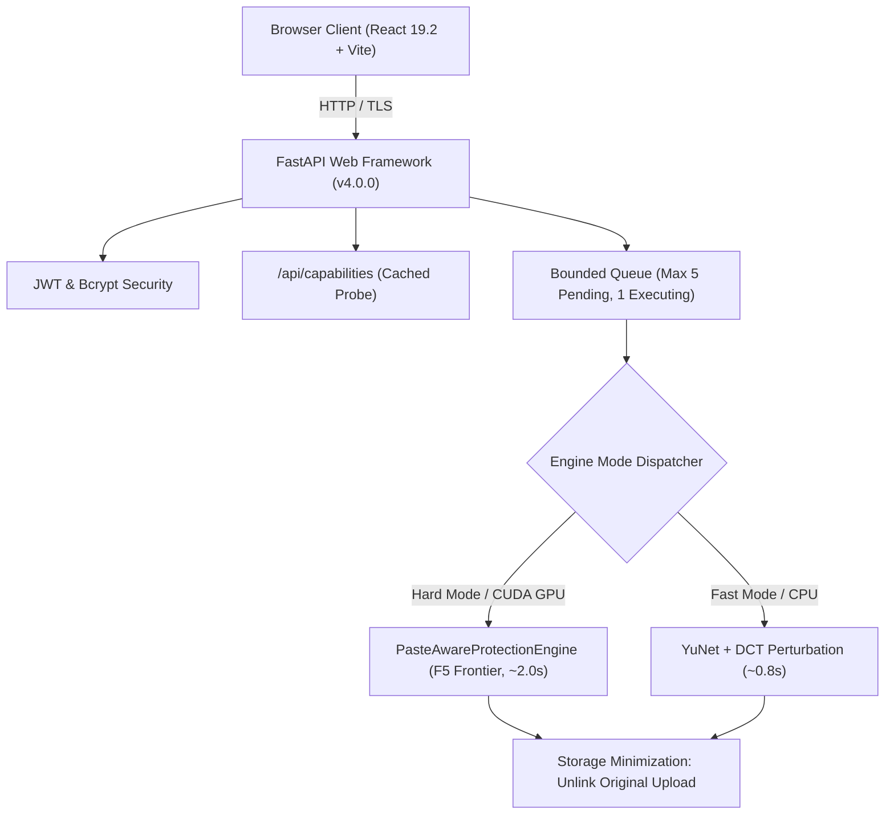

# Varman 4.0 — Operations & Deployment Runbook

This runbook provides deployment, configuration, local GPU acceleration setup, and operational guidance for **Varman 4.0** (v4.0.0 Production Release).

---

## 1. System Architecture Overview



Varman 4.0 operates across two distinct deployment topologies:
1. **CPU-Only Cloud Space:** Default free-tier container hosting (Hugging Face Docker Space / Cloud VM). Serves Fast Mode (CPU) exclusively. Hard Mode is disabled and protected by server-enforced `HTTP 409 Conflict` gating.
2. **GPU-Accelerated Host:** Dedicated or local server with CUDA acceleration. Serves both Fast Mode and full dual-surrogate Hard Mode (Preset F5).

---

## 2. Local GPU Acceleration Setup

> [!IMPORTANT]
> **Hardware Policy & Rule 0:**  
> The system operates under a permanent ₹0 ($0.00) budget constraint. Do not provision paid cloud GPU instances without explicit sign-off. In all public documentation, logs, and interfaces, hardware is referenced neutrally as "Local CUDA Host" or "Server GPU".

### Prerequisites
- OS: Linux (Ubuntu 22.04 LTS+) or Windows 10/11 (64-bit).
- NVIDIA Driver: Version 535.xx or newer.
- CUDA Toolkit: CUDA 12.1 or 12.4.
- GPU VRAM: Minimum 4.0 GB physical VRAM (peak engine consumption with autograd activations is ~666 MB reserved).

### Step-by-Step Installation
1. **Clone the repository:**
   ```bash
   git clone https://github.com/harshitsaini-hub/varman-backend.git
   cd varman-backend
   git checkout release/v4.0.0
   ```

2. **Create Python virtual environment:**
   ```bash
   python -m venv .venv
   source .venv/bin/activate   # On Windows: .\.venv\Scripts\Activate.ps1
   ```

3. **Install PyTorch with CUDA support:**
   ```bash
   pip install --upgrade pip
   pip install torch torchvision --index-url https://download.pytorch.org/whl/cu121
   ```

4. **Install backend dependencies:**
   ```bash
   pip install -r requirements.txt
   ```

5. **Verify GPU availability via the probe:**
   ```bash
   python -c "from app.protection.gpu_probe import probe_gpu_available; print('GPU Probe Result:', probe_gpu_available(True))"
   ```
   *Expected output:* `GPU Probe Result: True`

6. **Configure Environment Variables (`.env`):**
   ```ini
   DEVICE=cuda
   DATABASE_URL=sqlite+aiosqlite:///./varman.db
   STORAGE_DIR=./storage
   JWT_SECRET=generate-a-secure-256-bit-key
   CORS_ORIGINS=http://localhost:5173
   APP_ENV=production
   ```

---

## 3. Starting Services

### Backend Service
```bash
uvicorn app.main:app --host 0.0.0.0 --port 8000 --workers 1
```
*Note:* A single worker process is enforced to protect the bounded queue and singleton CUDA semaphore.

### Frontend Service (React 19.2 + Vite)
```bash
cd Varman-frontend
npm install
npm run build
npm run preview -- --port 5173
```

---

## 4. Monitoring & Operational Endpoints

| Endpoint | Method | Purpose | Normal Response |
| :--- | :---: | :--- | :--- |
| `/health` | `GET` | Container liveness check | `{"status": "ok", "service": "varman"}` |
| `/capabilities` | `GET` | Cached engine capabilities & modes | `{"gpu_available": bool, "modes_supported": [...], "max_queue_depth": 5}` |
| `/api/analytics/summary` | `GET` | Aggregate processing statistics | Total processed, average SSIM, PSNR, error rates |
| `/api/images/status/{id}` | `GET` | Job progress and full metadata | `status: "completed"`, `ssim_score`, `face_ssim_score`, `eot_steps_executed` |

---

## 5. Queue Management & Concurrency Controls

- **Active Concurrency:** Strictly bounded to 1 job via `asyncio.Semaphore(1)`.
- **Pending Queue Capacity:** Maximum 5 pending requests (`MAX_PENDING_QUEUE = 5`).
- **Overflow Policy:** Requests beyond capacity are rejected immediately with `HTTP 429 Too Many Requests` and header `Retry-After: 30`.
- **Cooperative Cancellation:** Clients can cancel in-flight jobs via `POST /api/images/cancel/{image_id}`. This triggers cooperative cancellation within the PGD step loop, safely detaching PyTorch tensors and freeing memory.
- **Process Restart Recovery:** During FastAPI lifespan startup, an automated sweep recovers all orphaned `pending` and `processing` database records to `failed` with error message `"Interrupted by server restart"`.

---

## 6. CPU-Only Failover & Consent Workflow

When running on a CPU-only server (e.g., Hugging Face Basic Space):
1. `/capabilities` returns `"gpu_available": false` and `"modes_supported": ["fast"]`.
2. Frontend fails closed: Hard Mode card is disabled and shows `"Server GPU Unavailable"`.
3. If an API request specifies `mode="hard"` without consent:
   - Backend returns `HTTP 409 Conflict`.
   - Error detail: *"Hard Mode requires a CUDA GPU. Server is CPU-only. Explicit consent (allow_cpu_fallback=true) required to proceed with Fast Mode (CPU)."*
   - Zero queue slots or disk storage are consumed.
4. If client consents (`allow_cpu_fallback=true`):
   - Backend accepts request with `HTTP 202 Accepted`.
   - Records `requested_mode="hard"`, `actual_mode="fast"`, `fallback_occurred=true`, `fallback_user_accepted=true`.
   - Executes Fast Mode pipeline and surfaces amber fallback indicator on results screen.

---

## 7. Hugging Face Space Container Risk & Rollback Protocol

> [!NOTE]
> **Space Container Verification & Outcome:**  
> The production Debian container (`Dockerfile` with `python:3.10-slim` and CPU-only PyTorch) was deployed to Hugging Face Spaces at commit `4637cda`, built successfully, and verified live. Cold startup was measured at ~10s, and all health and end-to-end API checks passed.
> 
> **Startup GPU Probe Timing:**  
> The GPU probe executes once during FastAPI `lifespan` startup. On the CPU Space (`CUDA_VISIBLE_DEVICES="-1"`), `probe_gpu_available()` completes in ~30ms and is cached in memory, serving `/api/capabilities` in $0.0026\text{ ms}$.
> 
> **Standard Rollback Procedure:**  
> If an issue arises with commit `4637cda` in the future, roll back without force-pushing or rewriting git history by creating and pushing a standard git revert:
> ```bash
> cd Varman-HF-Deploy
> git revert 4637cda --no-edit
> git push origin main
> ```
