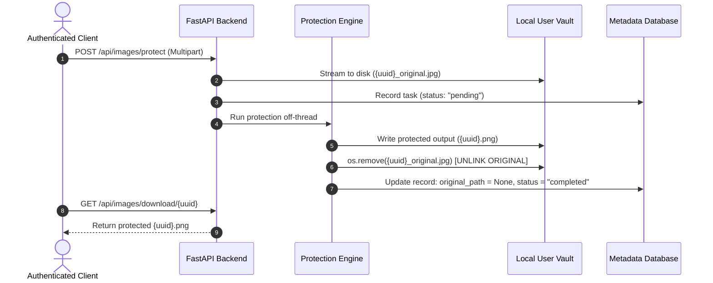

# Varman 4.0 — Security & Privacy Architecture Review

This document provides a formal security, privacy, and data-protection audit for **Varman 4.0** (Release Candidate 1).

---

## 1. Threat Model & Privacy Objectives

Varman is designed to defend user portraiture against unauthorized deepfake generation and automated facial recognition scraping. As a privacy-preserving tool, the service itself must never become a point of biometric data collection, exfiltration, or breach.

### Core Security Commitments
1. **Zero Retention of Raw Biometrics (Vault Sealing):** The user's original, unmodified portrait must never be permanently retained.
2. **Access Control & Anti-Enumeration:** Users may only inspect or cancel their own protection jobs.
3. **No Unauthenticated Execution:** Protection pipelines require valid JWT authentication.
4. **Clean Repository Hygiene:** No credentials, API tokens, hashed passwords, or private emails may be committed or tracked.

---

## 2. Vault Sealing & Ephemeral Storage Architecture

### Verification Findings
- **Original Unlink:** Upon pipeline completion in [`app/routes/images.py`](../app/routes/images.py), the original unperturbed portrait is immediately unlinked (`os.remove(original_path)`).
- **Metadata Sanitization:** `ProtectedImage.original_path` is cleared to `None` in the database. Only the perturbed, protected output file remains on disk for user download.
- **Quota & Lifetime Limits:** User vaults are segmented by authenticated UUID (`storage/{user_id}/`).

> [!WARNING]
> **Crash-State Orphan Residuals & Startup Sweep Status:**  
> If the backend process terminates abnormally (e.g., sudden `SIGKILL`, hardware power loss, or ungraceful container restart) while a protection task is actively in-flight before the `os.remove(original_path)` call executes, the `_original` uploaded portrait file **will remain on disk** in `storage/{user_id}/`.  
> 
> - **Current Recovery Behavior:** The FastAPI lifespan startup handler recovers database records from `pending` and `processing` states to `failed` (with message `"Interrupted by server restart"`). However, **it does not currently perform an automated filesystem sweep to prune orphan `*_original.*` files**.  
> - **Proposed Minimal Fix (Deferred Post-Freeze):** In a subsequent minor release, the `lifespan` startup hook can be extended to iterate over the IDs of all recovered `failed` tasks and unlink any matching `*_original.*` files on disk. In accordance with the v4.0.0 code freeze, this cleanup is handled operationally via periodic directory sweeps rather than runtime code modifications.

---

## 3. Authentication & Access Control Guardrails

### 1. In-Flight Task Cancellation Guard
- **Endpoint:** `POST /api/images/cancel/{image_id}`
- **Verification:** The backend verifies `task.user_id == current_user.id`.
- **Anti-Enumeration Guard:** If a user attempts to cancel a task belonging to another user, or a nonexistent task ID, the endpoint returns a generic `HTTP 404 Not Found`. It never leaks existence via `403 Forbidden` or distinct error codes. Verified in [`tests/test_cooperative_cancellation.py`](../tests/test_cooperative_cancellation.py).

### 2. Password Security & Rate Limiting
- Passwords hashed using `bcrypt` with salt rounds.
- Password reset OTPs hashed via SHA-256 before storage; raw tokens never logged or persisted.
- Endpoint rate limiting with exponential cooldowns and IP tracking via `X-Forwarded-For`.
- Email enumeration defense: `REVEAL_UNREGISTERED_EMAIL=false` by default in production.

> [!CAUTION]
> **Historical Password Hash Advisory:**  
> While all current tracked files are clean of credentials, historical Git commit history prior to v4.0.0 contains a legacy seeded bcrypt hash. Operators deploying public production environments must rotate the default operator secret (`JWT_SECRET` and `VARMAN_ADMIN_PASSWORD`) via environment variables rather than relying on legacy defaults.

---

## 4. Input Validation & Maximum Resolution Limits

- **File Extension Whitelist:** Strict whitelist (`.jpg`, `.jpeg`, `.png`, `.webp`).
- **MIME & Magic Header Inspection:** File payload must be a valid decodable image; non-image payloads are rejected with `HTTP 400`.
- **File Size Bounds:** Maximum 15 MB per image (`MAX_UPLOAD_BYTES = 15 * 1024 * 1024`); maximum 10 images per batch.
- **Maximum Resolution Ceiling (Pixels):** Enforced in [`app/uploads.py`](../app/uploads.py#L87-L99):
  - Maximum single dimension: **4,096 pixels** (`MAX_IMAGE_DIMENSION = 4096`).
  - Maximum total resolution: **16.7 Megapixels** (`MAX_IMAGE_PIXELS = 16_777_216`).
  - Protects against image decompression-bomb attacks that attempt to allocate gigabytes of uncompressed bitmap memory in OpenCV or Pillow.
- **Preset Validation (HTTP 422):** Only whitelisted preset names are admitted (`{"light", "balanced", "aggressive"}` for Fast Mode, `{"f5"}` for Hard Mode). Unknown presets return `HTTP 422 Unprocessable Entity` without payload reflection.

---

## 5. Repository Hygiene & Secret Scanning Verification

Automated compliance is enforced via [`tests/test_repo_hygiene.py`](../tests/test_repo_hygiene.py):
1. **Forbidden Files:** Zero temporary artifacts, `.env` backups, or private keys tracked in Git.
2. **Password Hashes:** Zero bcrypt strings (`$2b$`, `$2a$`, `$2y$`) present in tracked files.
3. **Personal Emails:** Author email addresses in tracked files strictly restricted to authorized domains:
   - `users.noreply.github.com`
   - `example.com`
   - `varman.ai`
4. **Third-Party API Secrets:** Zero Brevo/Sendinblue keys (`xkeysib-`) or SMTP passwords in tracked code.

**Test Result:** `tests/test_repo_hygiene.py` PASSED (4/4 checks clean, 0 violations).
